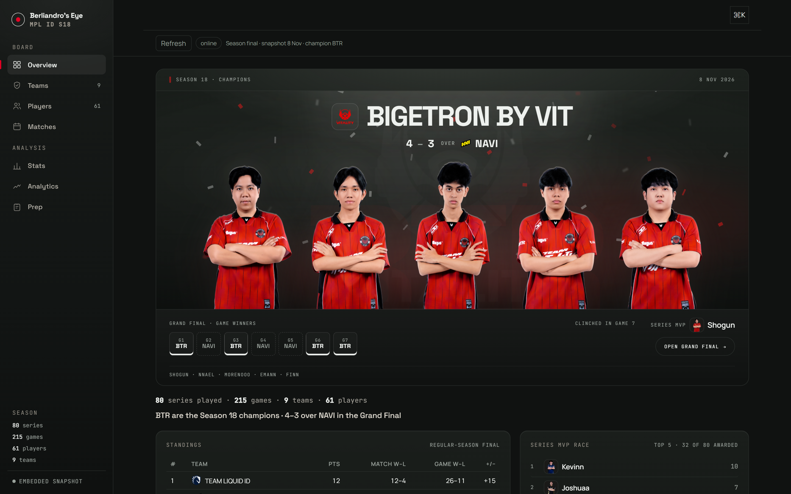
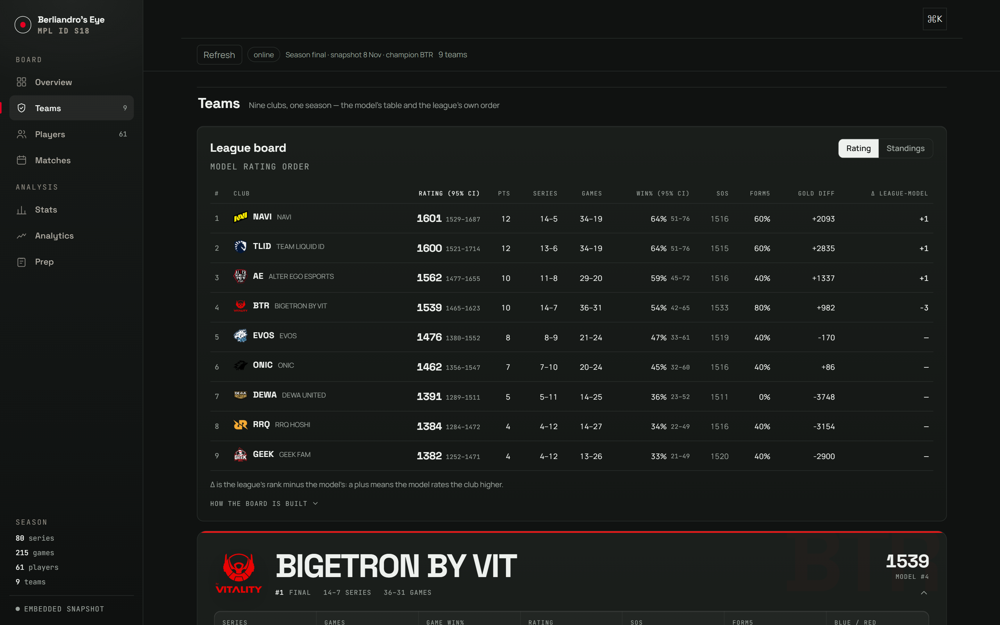
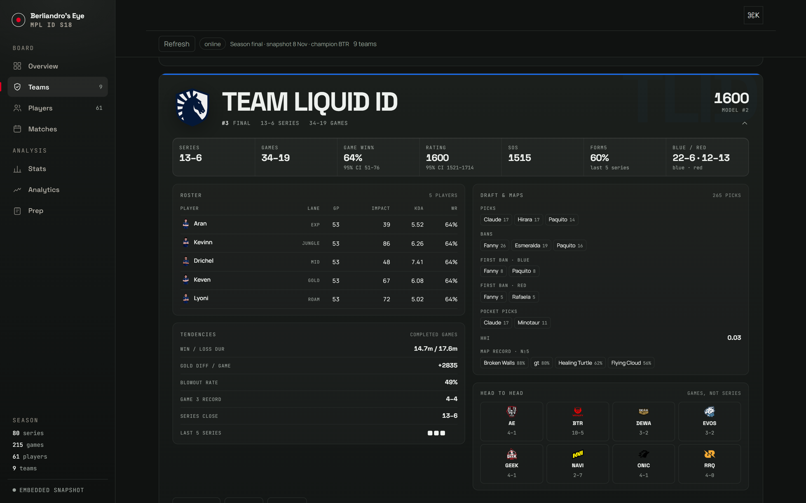
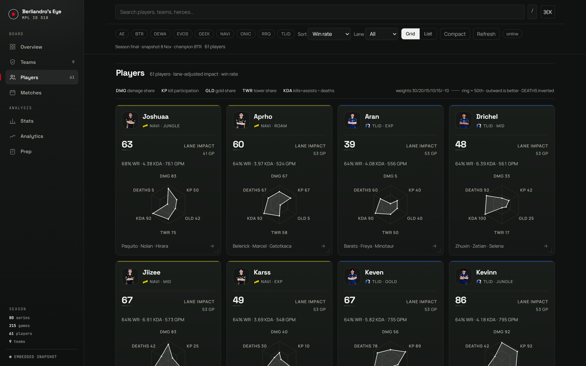
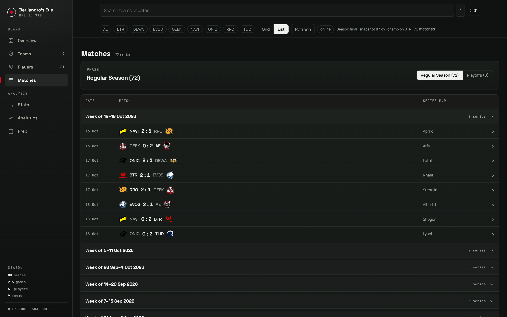
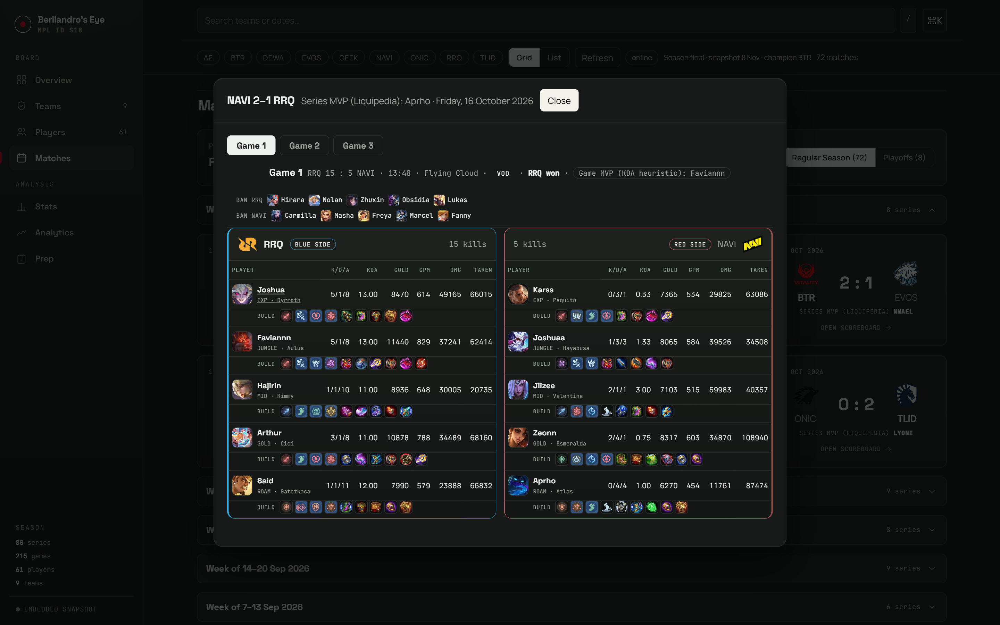
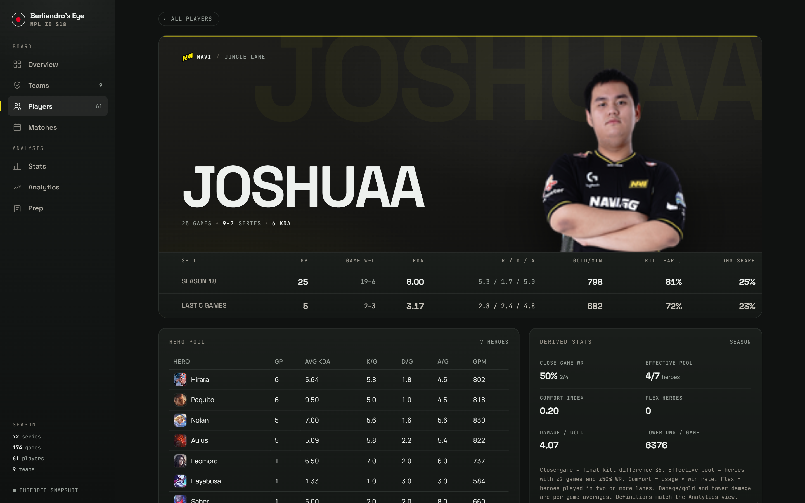
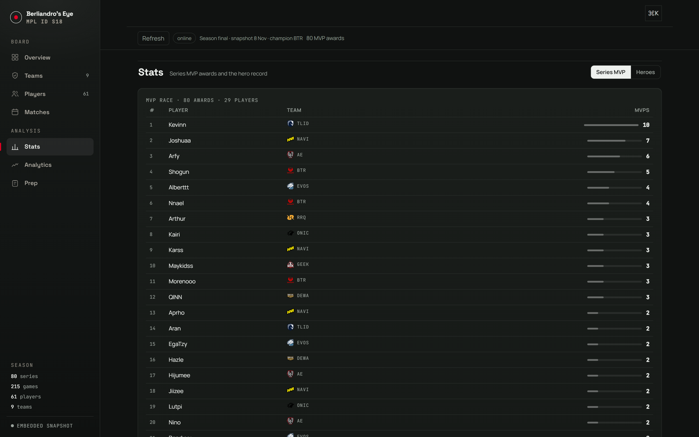
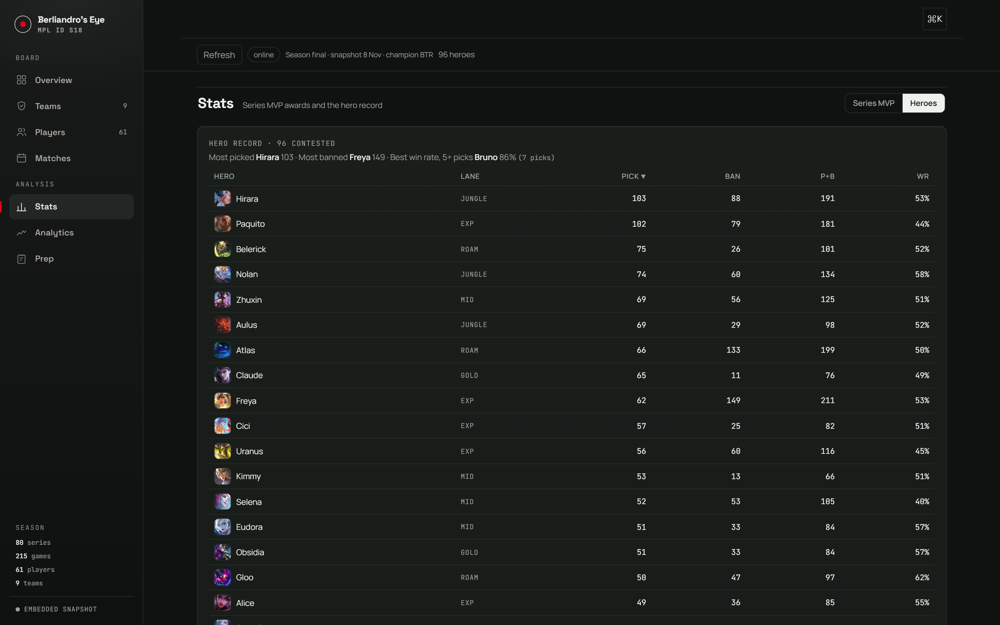

# Berliandro's Eye — MPL Indonesia Season 18

[](https://github.com/berliandro/berliandros-eye-mpl-s18/actions/workflows/ci.yml)
[](https://github.com/berliandro/berliandros-eye-mpl-s18/actions/workflows/semantic-check.yml)

**Berliandro's Eye** is an unofficial, evidence-first record of **MPL Indonesia Season 18**:
every series, game, recorded pick and ban, and per-player statistic from the completed season,
presented as a fast single-file web app. It is built for two readers: a fan who wants an answer
in seconds, and a coach who needs an opponent report they can defend.

Season 18 is complete: **80 series (matches) and 215 games**, with **BTR beating NAVI 4–3 in
the Grand Final**. The app ships as `mpl_id_s18_dark.html` plus the committed `assets/` folder.
The snapshot is embedded, so the whole season renders offline; **Refresh** pulls live data from
the public mlbbhub and Liquipedia APIs when a network is available.

Rates carry their sample size and, where available, a 95% interval. Missing values render as
`–` with a reason; heuristics are labelled; nothing is estimated silently.

**Live app:** <https://berliandro.github.io/berliandros-eye-mpl-s18/> ·
[Data dictionary](docs/DATA_DICTIONARY.md) ·
[Roadmap](docs/ROADMAP.md) ·
[Coaching layer](analysis/README.md)

> **Unofficial project.** Not affiliated with Moonton, MPL or any team. Data is collected from
> public endpoints and cross-checked against official standings, the schedule and Liquipedia
> drafts; see [Data sources and attribution](#data-sources-and-attribution).

**Contents:** [Features](#features) · [Screenshots](#screenshots) · [Technology stack](#technology-stack) ·
[How it works](#how-it-works) · [How the numbers are derived](#how-the-numbers-are-derived) ·
[Getting started](#getting-started) · [Commands](#commands) · [Project structure](#project-structure) ·
[Testing](#testing) · [Deployment](#deployment) · [Coaching and transcript layer](#coaching-and-transcript-layer) ·
[Data sources and attribution](#data-sources-and-attribution) · [Troubleshooting](#troubleshooting) ·
[Contributing](#contributing) · [Documentation](#documentation) · [License and disclaimer](#license-and-disclaimer)

## Features

Seven views, one job each.

| View | What it gives you |
|---|---|
| **Overview** | Champion, final standings, Series MVP race and latest results |
| **Teams** | Nine team dossiers: rating with intervals, form, roster, tendencies, draft fingerprint, map record and head-to-head |
| **Players** | Lane-normalised impact, percentile profile and season stats for all 61 players |
| **Matches** | Week-grouped fixtures, playoff bracket, per-game scoreboards, bans in draft order and VOD links |
| **Stats** | Series MVP race and a sortable hero pick/ban/win dashboard |
| **Analytics** | Lane-normalised player impact and draft/meta analysis, with intervals and method notes |
| **Prep** | One-page opponent report: likely picks and bans, map strengths, player matchups and head-to-head |

Across every view:

- **Search and shareable state.** `Ctrl/⌘K` opens a palette across players, teams, heroes and
  matches. View, team, analytics and prep selections are written to the URL, so a dossier, a
  filtered match list and a prep report are all shareable.
- **Filters, sorting and drill-downs.** The Players view filters by team, lane and search, and
  sorts by win rate, lane impact, KDA, kills, gold or games. The hero table and MVP history sort
  from their column headers. Hero, item, emblem, talent, opponent and game names open detail
  dialogs; a hero's game list opens the exact game.
- **One player identity.** Liquipedia MVP spellings are normalised to a canonical player (for
  example Coolfire → Joshuaa, JOOOOO → Kevinn, Sutsujin → Arthur, Lynchh → Joshua; see
  `data/global/aliases.json`), so aliases aggregate instead of splitting into phantom players.
  The source spelling is kept as an “as …” note.
- **Offline-first refresh.** The embedded snapshot renders instantly. Refresh re-fetches live
  data with retry and timeout, merges per match, keeps previous records for failed match IDs
  instead of partially overwriting them, and caches under a versioned `localStorage` key. The
  status line distinguishes `updated` from `partially updated`; a failed refresh leaves the
  last snapshot in place.
- **Exports.** Prep can print to PDF and export CSV; a print stylesheet covers every view.

## Screenshots



<details>
<summary>More screenshots (9)</summary>

**Teams — the nine-team league board, rating first.**



**Team dossier — crest identity, season band, roster, tendencies, draft and head-to-head.**



**Players — lane impact, win rate and a six-axis percentile hexagon.**



**Matches — fixtures grouped by week, with the Series MVP per row.**



**Matches — week-grouped cards.**


**Scoreboard — per-team tables, series score, both MVPs and bans in draft order.**



**Player profile — identity plate, season band, hero pool and derived stats.**



**Stats — Series MVP race with team crests.**



**Stats — hero pick/ban/win dashboard.**



</details>

## Technology stack

| Layer | What is used |
|---|---|
| App | One generated HTML file; hand-written CSS and vanilla JavaScript; no runtime dependencies |
| Data | SQLite snapshot, CSV exports and JSON season configuration |
| Pipeline | Python 3.12 standard library for collection, build and verification |
| Tests | Node.js 24 for the JavaScript engines; Python `unittest` for data and schema checks |
| CI | GitHub Actions: build, 29-suite regression and semantic validation |
| Hosting | GitHub Pages, branch deployment from `main` |

The full verification suite also needs `ruff` and `jsonschema`. Pillow is needed for portrait
derivatives and team colours; Playwright and Chrome for screenshots.

## How it works

The committed database is the source of truth for every number; the HTML and CSVs are generated
from it.

```text
mlbbhub API ──┐
Liquipedia ───┴──► tools/etl.py ──► data/ (SQLite, CSV, provenance)
                                              │
                                              ▼
                                   tools/gen_dark.py ──► mpl_id_s18_dark.html
                                              │
                                              └──► assets/
```

1. **Collect.** `tools/etl.py` pulls schedule, results, standings, per-player stats and bans
   from mlbbhub, then enriches picks, lane slots, ban order, map mode, VODs and Series MVPs
   from Liquipedia. Network calls are manual and use identifying user agents.
2. **Store.** `data/mpl_id_s18.db` is the durable snapshot. CSV exports,
   `data/seasons/s18/meta.json` and `quality.json` record the build and its exceptions.
3. **Build.** `tools/gen_dark.py` reads the committed data and inlines the templates from
   `tools/templates/` into one HTML file. Artwork stays in `assets/` on relative paths.
4. **Verify.** `tools/verify.py` runs the 29-suite gate, ending with a byte-for-byte
   regeneration parity check against the committed artifact.
5. **Publish.** GitHub Pages serves `main`; there is no server-side component.

The provenance record in `meta.json` carries the schema version, sources, row counts, build
commit and reconciliation totals. `quality.json` lists source conflicts and known gaps, such
as the one game with nine recorded bans. A refresh is labelled final only when all 72 completed
regular fixtures have detail, the standings totals agree, and every game retains ten picks,
two team rows, recorded sides and at least nine bans. The committed snapshot also carries the
eight playoff series.

## How the numbers are derived

- **Game MVP.** The mlbbhub API exposes no per-game MVP, so the app awards it to the
  **highest-KDA player on the winning team** (tiebreaks: kills, then gold). Series MVP comes
  from Liquipedia.
- **MANIAC / SAVAGE.** Not available. No API endpoint or official MPL Indonesia page publishes
  kill-streak data (the official leaderboard exists for MPL MY only), so these columns render
  `–` rather than being estimated.
- **Intervals and models.** Lane percentiles shrink toward the lane mean with a five-game
  prior; win rates use 95% Wilson intervals and always show `n`; team ratings use
  Bradley-Terry, a paired-comparison strength model, on one paired observation per game with 100
  game-level bootstrap resamples. The Prep ban ranking is a pick-threat proxy (opponent pick
  rate × pick win rate), not a claim about their ban intent.
- **Weights and caveats.** The impact composite is pinned by `tools/test_analytics.js`; exact
  weights, formulas and caveats are printed in the product's method disclosures. The
  [data dictionary](docs/DATA_DICTIONARY.md) documents the tables, fields and derived metrics.

## Getting started

There are two paths: read the season in the hosted app, or build and verify the project
locally.

### Use the hosted app

Open <https://berliandro.github.io/berliandros-eye-mpl-s18/>. No account, installation or build
step is required. The root URL redirects to `mpl_id_s18_dark.html` and preserves any hash.

### Run it locally

```bash
git clone https://github.com/berliandro/berliandros-eye-mpl-s18.git
cd berliandros-eye-mpl-s18
```

You can open `mpl_id_s18_dark.html` directly: the snapshot is embedded and artwork uses
relative paths. To serve the folder over HTTP instead:

```bash
python -m http.server 8931
# http://localhost:8931/mpl_id_s18_dark.html
```

If `python` is not on `PATH`, use your platform's launcher (for example `py` on Windows). Some
browsers restrict network requests from `file://`; use the local server when testing **Refresh**.

### Prerequisites

| Tool | Version | Needed for |
|---|---|---|
| Python | 3.12 | ETL, build and verification |
| Node.js | 24 | JavaScript test suites in `verify.py` |
| Ruff | 0.17.0 | Lint step in `verify.py` |
| jsonschema | current release | Transcript ledger tests in `verify.py` |

Python and Node.js match the CI configuration; Ruff is pinned to 0.17.0 and jsonschema is
installed from the current release.

Optional tooling:

| Tool | Needed for |
|---|---|
| Pillow | `tools/make_player_cards.py`, `tools/derive_team_colors.py` |
| Playwright + Google Chrome | `tools/shots.py` screenshot capture |

### Install tooling

```bash
python -m pip install "ruff==0.17.0" jsonschema
```

The repository has no package manifest: the app has no runtime dependencies and the Python
pipeline uses the standard library. These packages, plus Node.js, satisfy the full verification
suite. No `npm install` is needed.

Environment variables are not required for the app, ETL, build or standard verification. The
optional DeepSeek visual-review tooling reads `DEEPSEEK_API_KEY`; nothing documented here needs
it.

### Build from committed data

```bash
python tools/gen_dark.py
python tools/verify.py
```

`gen_dark.py` rewrites the app from committed data and templates. `verify.py` rebuilds it again
as its parity check, compares the result byte-for-byte, and runs the rest of the gate. A clean
run ends with:

```text
VERIFY PASS (29/29 suites)
```

### Rebuild the data

```bash
python tools/etl.py --season s18
python tools/gen_dark.py
python tools/verify.py
```

The ETL needs network access and makes roughly 70 sequential requests. It publishes atomically:
if it fails, the previous database is left intact. Because Season 18 is complete, a refresh is
mainly useful for upstream corrections; the committed snapshot is the stable record.

## Commands

**Data pipeline**

| Command | What it does | Network |
|---|---|---|
| `python tools/etl.py --season s18` | Rebuild the database: mlbbhub API, then Liquipedia enrichment | Yes |
| `python tools/build_s18_db.py` | Run the API-only ETL (no picks, per-game lanes or map mode) | Yes |
| `python tools/enrich_drafts.py --season s18` | Re-run the Liquipedia enrichment only | Yes |
| `python tools/aggregate_teams.py --season s18` | Recompute team aggregates from player rows | No |
| `python tools/fetch_hero_classes.py --season s18` | Rebuild hero role, lane and damage metadata | Yes |

**Build and verification**

| Command | What it does | Network |
|---|---|---|
| `python tools/gen_dark.py` | Rebuild the single-file app from committed data | No |
| `python tools/build.py --season s18` | Season-aware wrapper around the build | No |
| `python tools/verify.py` | Run the standard 29-suite gate | No |
| `python tools/check.py [--live]` | Data integrity, asset coverage and link checks | Optional |
| `python tools/check_parity.py` | Regenerate and compare the committed artifact | No |
| `node tools/test_analytics.js` | Run one JavaScript suite directly | No |

**Artifacts and maintenance**

| Command | What it does | Network |
|---|---|---|
| `python tools/fetch_assets.py [--check-only] [--live]` | Download missing artwork or audit coverage | When fetching |
| `python tools/make_player_cards.py [--check]` | Build or verify 160px portrait derivatives | No |
| `python tools/derive_team_colors.py` | Re-derive team accents from committed logos | No |
| `python tools/shots.py --zoom` | Recapture the README screenshots | No |
| `python tools/verify_analysis.py` | Run the transcript layer suite; needs the local corpus | No |

`verify.py` runs the required JavaScript and Python suites, Ruff, `check.py` and the parity
check. Individual suites live in `tools/test_*.py` and `tools/test_*.js`.

## Project structure

```text
.
├── mpl_id_s18_dark.html      generated app (open this)
├── index.html                hash-preserving redirect to the app
├── 404.html                  GitHub Pages not-found page
├── favicon.ico               project icon — the rail logo at 16/32/48/64
├── icon.png, apple-icon.png  the same mark at 512 and 180 px
├── .nojekyll                 stop Jekyll processing on the branch
├── PRODUCT.md, DESIGN.md     product context and design system
├── assets/                   committed artwork, manifest and og-card
├── data/
│   ├── mpl_id_s18.db         SQLite snapshot (source of truth)
│   ├── csv/                  CSV exports generated from the database
│   ├── season.json           Season 18 rules, slots, priors and endpoints
│   ├── playoffs.json        final bracket, seeding and Grand Final payload
│   ├── registry.json         season registry
│   ├── global/               player aliases, hero/item classes, team colours
│   └── seasons/s18/          provenance (meta.json) and exceptions (quality.json)
├── tools/
│   ├── templates/            doc.html, style.css, app.js — the single source
│   ├── *.py                  collection, enrichment, build, verification and tests
│   └── test_*.js             JavaScript engine suites
├── analysis/                 transcripts, evidence, reports and coaching briefs
├── docs/                     roadmap, data dictionary and insight catalogue
├── github/assets/            README screenshots
└── .github/workflows/        regression and semantic-validation CI
```

The generated HTML is committed. Do not edit it by hand: change the templates or the data,
rebuild, and let `verify.py` prove the artifact matches.

To work on the app, start with `tools/templates/app.js` for the interface, `tools/gen_dark.py`
for the build, and `tools/etl.py` for collection. To inspect the data directly, open
`data/mpl_id_s18.db` with any SQLite client or read the exports in `data/csv/`.

## Testing

`python tools/verify.py` is the standard gate. It runs 29 suites in order and fails loudly when
a runtime or dependency is missing:

- JavaScript syntax and engine suites: probability, analytics, refresh merge, cache, snapshot
  derivation, season finalisation, transforms, XSS sinks and item classification.
- Python suites: season config, aliases, draft and lane enrichment, hero classes, team
  aggregates, cross-view reconciliation, transcript ledger, stats bridge and goal records.
- Ruff lint over `tools/`.
- `tools/check.py`: data integrity, asset coverage and generated markup.
- Regeneration parity: a fresh build must be byte-identical to the committed artifact.

The `regression` workflow runs the same gate on every push to `main` and every pull request
targeting it. The separate `Semantic Analysis Validation` workflow checks the transcript
evidence layer. To run that layer locally, use `python tools/ci_semantic_check.py` or
`python tools/verify_analysis.py` (the latter needs the local corpus, which is not committed).

## Deployment

The site is static and deploys from `main` through GitHub Pages:

1. `python tools/gen_dark.py`
2. `python tools/verify.py`
3. Commit the data, templates and regenerated `mpl_id_s18_dark.html`.
4. Push to `main`.

`index.html` redirects to the app while preserving the URL hash; `.nojekyll` stops GitHub Pages
from running Jekyll on the branch; `404.html` handles unknown paths. `assets/` must ship beside
the HTML. There is no server-side component, database service or build step at request time.

## Coaching and transcript layer

A separate, auditable transcript and database layer lives in
[`analysis/`](analysis/README.md). It imports the local nine-week broadcast corpus, verifies
SHA-256 manifests, aligns captions to series and games, and publishes database evidence plus
coaching briefs.

Current coverage: **27/27 source records verified, 72/72 match reports with database evidence,
27 transcript-covered series (24 complete, 3 partial), 45 database-only series, and 313
accepted observations.** The coaching product is nine team briefs and one head-coach brief.
Gameplay observations remain text-only because no same-frame `00:00` boundary has been verified
for visual proof.

The semantic layer is pinned to the regular-season snapshot
`analysis/snapshots/mpl_id_s18_regular.db` (72 series, 174 games); the app database is the
completed season (80 series, 215 games). Raw transcripts, frames and caches stay local and are
ignored by Git; the committed layer is the manifests, schemas, reports and briefs. Start at
[`analysis/reports/coverage-matrix.md`](analysis/reports/coverage-matrix.md).

## Data sources and attribution

| Source | Used for |
|---|---|
| `mpl.mlbbhub.com/api/v1/id` | Schedule, results, standings, per-player stats and bans |
| `liquipedia.net/mobilelegends/api.php` | Picks, lane slots, ban order, map mode, VODs, Series MVPs and schedule cross-checks |
| Liquipedia Commons | Player portraits (CC-BY-SA 3.0) |
| mlbbhub, Liquipedia infoboxes and scoregg CDN | Hero and item artwork |

The ETL calls the public JSON endpoints and the MediaWiki `api.php` interface with identifying
user agents (`MPL-S18-research/1.0`, `MPL-S18-assets/1.0`), only on manual invocation. The
in-app Refresh runs in the browser on a button press and uses the browser's own user agent. One
ETL run makes roughly 70 sequential requests; one Refresh makes about 60 detail requests at
6-way concurrency plus 6 list requests with one retry each. The app has no accounts, cookies or
analytics; the only persistent state is the versioned snapshot in `localStorage`.

`robots.txt` disallows crawling `/mobilelegends/api.php` for generic agents, and the sites'
terms of service were not independently reviewed. Usage here is minimal, manual and
non-commercial, but compliance is not claimed.

## Troubleshooting

| Symptom | Likely cause | Fix |
|---|---|---|
| `verify.py` reports a missing runtime | Node.js is not installed or not on `PATH` | Install Node.js 24 and reopen the shell |
| `verify.py` fails the Ruff step | Ruff is missing | `python -m pip install "ruff==0.17.0"` |
| `jsonschema is required` | The schema validator is missing | `python -m pip install jsonschema` |
| Parity gate fails | Templates or data changed without a matching rebuild | Inspect `git diff`; commit the regenerated HTML if the change was intended, otherwise revert the source change, then rerun `verify.py` |
| `verify_analysis.py` fails on a clean clone | Raw transcripts are not committed and are absent | Run it only where the local corpus exists; CI uses `ci_semantic_check.py` |
| Refresh says `partially updated` | Some match requests failed; previous records were kept | Retry; if it persists, check network and API availability |
| Refresh fails after an upstream API change | The public endpoint's shape or availability changed | The snapshot stays usable; update the fetch/parse code and its tests, then rebuild |
| GitHub Pages shows a 404 | The app lives at `mpl_id_s18_dark.html`, not at a directory route | Open the root URL or `/mpl_id_s18_dark.html` |
| Refresh says `not cached: storage full` | The browser's `localStorage` quota is full | Clear the site's storage and reload |
| ETL fails mid-run | Network or upstream source change | The last known-good database is kept; rerun `tools/etl.py` |
| Screenshots fail | Playwright, Chrome or the hardcoded Chrome path is missing | Install Playwright and Chrome, or adjust `CHROME` in `tools/shots.py` |
| Asset coverage reports gaps | Artwork is missing from the checkout | `python tools/fetch_assets.py`, then rebuild |

## Contributing

- Run `python tools/verify.py` before opening a pull request. Both CI workflows must pass.
- Keep the generated `mpl_id_s18_dark.html` in sync with its templates and data; the parity
  gate enforces this.
- Do not commit raw transcripts, captured frames or caches. They are excluded from the
  repository by design.
- Record source disagreements and data-quality exceptions in
  `data/seasons/s18/quality.json`; do not silently patch a conflict.
- For substantial changes, open an issue first so the data and provenance consequences can be
  reviewed.

## Documentation

- [Roadmap](docs/ROADMAP.md)
- [Data dictionary](docs/DATA_DICTIONARY.md)
- [Insight catalogue](docs/INSIGHT_CATALOGUE.md)
- [Analysis layer](analysis/README.md)
- [Coverage matrix](analysis/reports/coverage-matrix.md)
- [Product context](PRODUCT.md)
- [Design system](DESIGN.md)

## License and disclaimer

No `LICENSE` file is currently included, so the repository grants no reuse rights beyond
GitHub's terms. Third-party assets keep their own licenses: Liquipedia Commons portraits are
CC-BY-SA 3.0, and hero and item artwork belong to their respective owners.

This is an unofficial, non-commercial project. It is not affiliated with, endorsed by or
sponsored by Moonton, MPL or any team. For decisions that matter, verify every number against
the official broadcast and the official MPL record.
