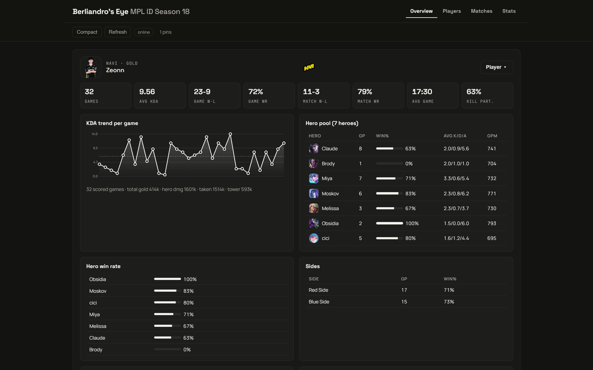
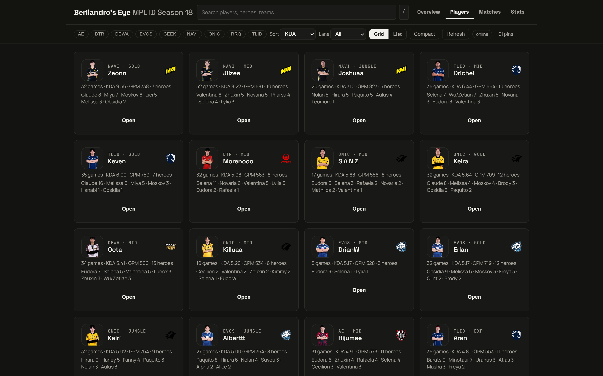
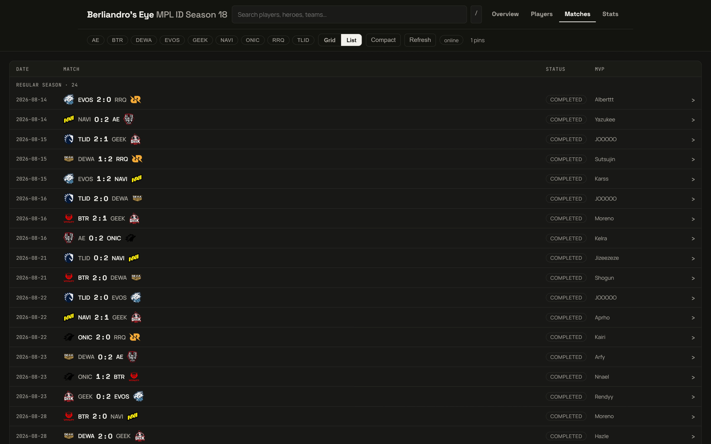
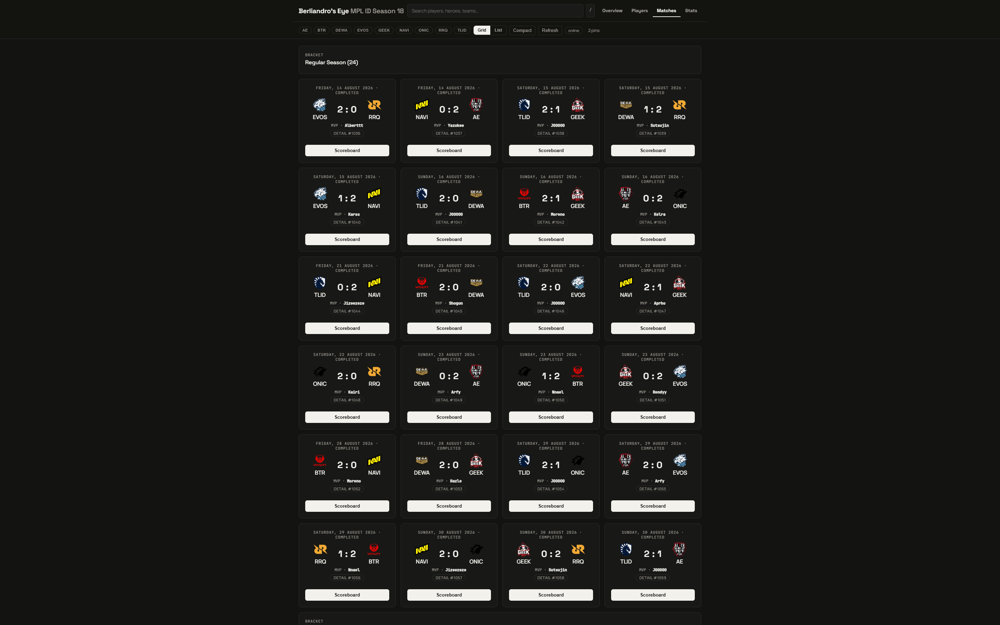
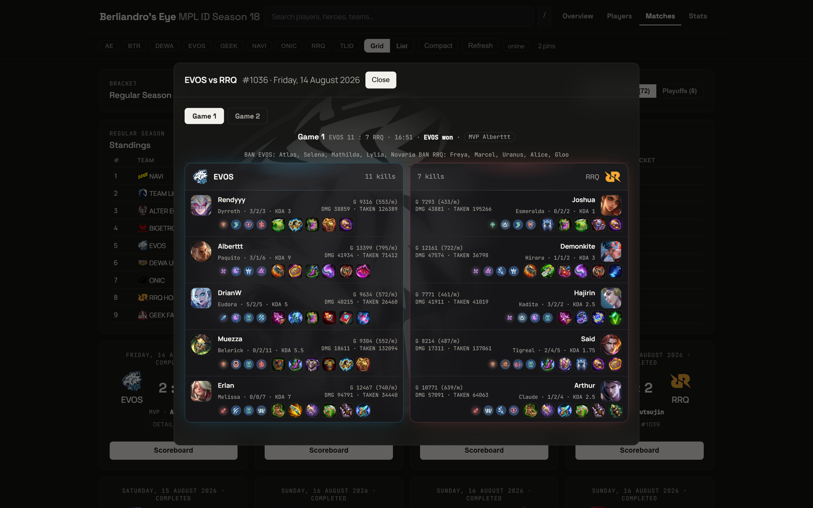
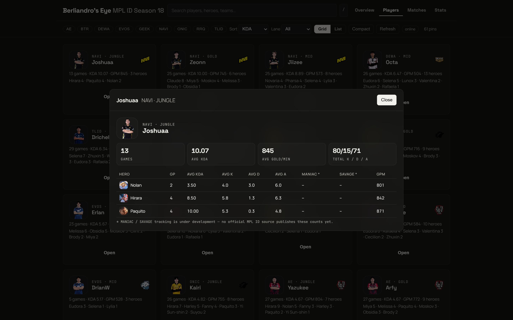
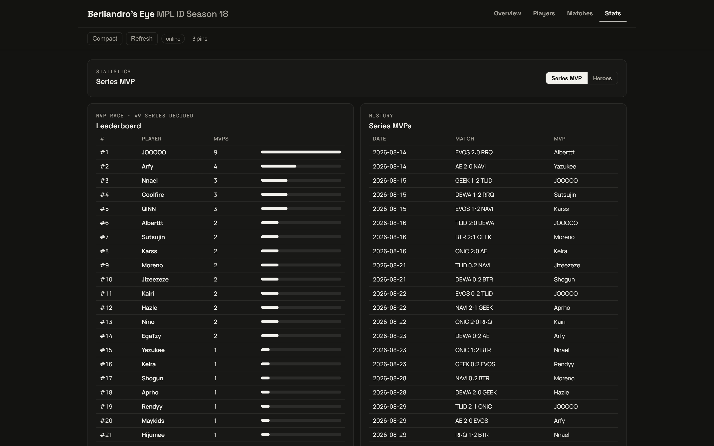
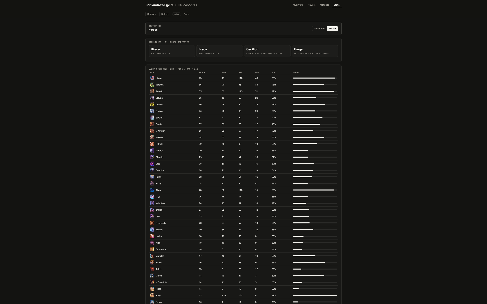

# Berliandro's Eye - MPL ID Season 18

A dark, minimalist, frosted-glass web app for exploring **MPL Indonesia Season 18**
(regular season + playoffs): player stats, match scoreboards, standings, and series MVPs.
Ships as a **single self-contained HTML file** (`mpl_id_s18_dark.html`) with all data
and hero/item artwork embedded — it works offline from the snapshot and refreshes
live from the mlbbhub API when online.

## Screenshots

### Overview — player deep dive (KDA trend, hero pool, win rates, items, game log)


### Players — sortable cards with hero pools


### Matches — full-width list layout with series MVP per match


### Matches — grid layout with series MVP per card


### Scoreboard — symmetrical 50/50 split, per-game MVP, first-pick glow


### Player card — per-hero AVG KDA / K / D / A, MANIAC, SAVAGE (🚧 under development)


### Stats — Series MVP race leaderboard + history


### Stats — Heroes dashboard (highlights + sortable pick/ban/win table)


## Features

- **Overview** — pick any player: tiles (games, avg KDA, game/match W-L + WR, avg game
  time, kill participation), KDA-trend chart, hero pool with win rates, side splits,
  top items, emblems & talents, record by opponent, series MVPs, full game log.
- **Players** — grid/list cards with photos, KDA, GPM, hero pools; filter by team,
  lane, search text; sort by KDA / games / kills.
- **Matches** — full-width frosted list (date, logos, score, status, series MVP) and
  grid cards (also showing series MVP). A Regular/Playoffs sub-tab switches phases.
  Regular phase shows the **standings board** and **team profiles** (games, W-L,
  KDA, avg gold, avg game) on top; Playoffs shows **final positions** plus a
  **bracket preview** (Round 1 → Grand Final) under the history. Completed cards
  open the scoreboard.
- **Scoreboard dialog** — symmetrical 50/50 team split with first-pick blue/red glow,
  centered header (score, duration, **map mode**, date), full-width **bans in draft
  order**, lane-ordered player rows (EXP/JUNGLE/MID/GOLD/ROAM), a **per-game MVP
  pill** next to “TEAM won”, and a **VOD deep link**.
- **Player dialog** — per-hero table: GP, AVG KDA (`00.00`), AVG K, AVG D, AVG A,
  MANIAC, SAVAGE, GPM, plus close-game WR, effective pool, comfort/flex, damage per
  gold, tower damage per game, an opponent split, and hero-fit vs the league.
- **Stats** — sub-tabbed dashboard: **Series MVP** (race leaderboard + history) and
  **Heroes** (highlight tiles + sortable pick/ban/win table with **role, lane and
  damage-type columns** and share bars).
- **Analytics — Players** — lane-normalised player impact (35% damage share, 25% kill
  participation, 20% gold share, 10% tower share, −10% death share), shrunk toward
  the lane mean with a 5-game prior. Shows KDA/GPM/damage/KP percentiles, a 95%
  Wilson win-rate interval, form delta, and mutes rows under 5 games. The method
  and weights are printed in-product.
- **Analytics — Teams** — Bradley-Terry ratings with bootstrap CIs, strength of
  schedule, form (games and series), blue/red splits, tempo, dominance, clutch
  (game 3 and series close), map records, and a head-to-head game matrix.
- **Analytics — Draft** — hero pick/ban/WR with CIs and flex, same-team synergy,
  opposing-pair counters, team fingerprints (top picks/bans, first-ban by side,
  HHI, pocket picks), composition archetypes, map meta, and week-over-week meta
  movement. Pair/counter deltas are labelled as descriptive proxies, not causal.
- **Prep** — pick an opponent (and optionally our team) for a one-page scouting
  report: rating/form/side/tempo, likely picks and bans, a transparent ban ranking,
  player weaknesses/strengths, weak/strong maps, H2H and lane matchups; print/PDF,
  CSV, and a copyable permalink.
- **Search + links** — `Ctrl/⌘K` palette across players, teams, heroes and matches;
  view/analytics/prep state is written to the URL so links restore the report.
- **Tables and identity** — Every statistic column sorts ascending/descending with
  a minimalist ▲▼ indicator.
  MVP names from Liquipedia are normalized to one canonical player identity
  (e.g. Coolfire → Joshuaa, JOOOOO → Kevinn, Sutsujin → Arthur,
  Lynchh → Joshua — see `data/global/aliases.json`), so aliases aggregate instead of
  splitting into phantom players; the source spelling is kept as an “as …” note.
  Every hero opens a drill-down modal (picks/bans/WR tiles, most-used
  items/emblems/talents, players with counts, and a game list with
  `DATE | MATCH | GAME | TYPE | RESULT` columns that opens the exact game);
  PICK rows show the hero's team result as Win/Loss while BAN rows stay neutral,
  and assets drill further into global usage.
- **Offline-first** — embedded snapshot renders instantly; Refresh re-fetches live
  data with retry/timeout, merges per-match results (failed match IDs keep
  their previous records, never partial-overwritten), caches to a versioned
  `localStorage` key, and reports `updated` vs `partially updated` status.
  A failed ETL build keeps the last known-good database/CSVs (rerun to
  retry); a failed refresh keeps showing the last snapshot. To reset cached
  data, clear the site's `localStorage` and reload.

## Stat notes (how derived numbers work)

- **Game MVP**: the mlbbhub API exposes no per-game MVP (game `summary` is empty), so
  the app awards it to the **highest-KDA player on the winning team**
  (tiebreaks: kills, then gold). Series MVP comes from Liquipedia.
- **MANIAC / SAVAGE**: 🚧 **Under development** — no API endpoint (`/match`,
  `/stats/players`, `/stats/heroes`) or official MPL ID page publishes kill-streak
  data (the official leaderboard exists for MPL MY only), so these columns render
  `–` until a source exists. They are never fabricated.
- **Analytics / Prep**: lane percentiles shrink toward the lane mean with a
  5-game prior; win rates use 95% Wilson intervals and show `n`; impact weights
  are pinned by `tools/test_analytics.js`; team ratings are Bradley-Terry with
  100 bootstrap resamples; the ban score is an explicit presence × win-rate
  proxy. Formulas and caveats are in-product and in
  [`docs/DATA_DICTIONARY.md`](docs/DATA_DICTIONARY.md).

## Project layout

| Path | What it is |
|---|---|
| `mpl_id_s18_dark.html` | Built app (generated — open this in a browser) |
| `tools/templates/` | Single source: `doc.html`, `style.css`, `app.js` |
| `tools/build_s18_db.py` | API ETL: mlbbhub + Liquipedia → SQLite + `data/csv/` |
| `tools/enrich_drafts.py` | Liquipedia enrichment: picks, lane order, ban order, map mode (idempotent) |
| `tools/fetch_hero_classes.py` | Build `hero_classes.json` from Liquipedia hero infoboxes (role, lane, specialties) |
| `tools/aggregate_teams.py` | Rebuild `team_games` / `team_season_stats` from player rows (no network) |
| `tools/gen_dark.py` | Build: CSV + assets → `mpl_id_s18_dark.html` |
| `tools/fetch_assets.py` | Download every referenced hero/item asset (`--check-only`, `--live`) |
| `tools/check.py` | Regression suite (incl. STRICT asset coverage + JS syntax gate) |
| `tools/verify.py` | Standard verification: all unit suites + `check.py` + parity gate |
| `tools/test_chances.js` | Probability-engine tests (node) |
| `tools/test_refresh.js` | Live-refresh merge tests (node) |
| `tools/test_analytics.js` | Analytics engine fixtures: Wilson, shrinkage, player/team/draft metrics, ban ranking (node) |
| `docs/` | Roadmap, data dictionary and insight catalogue |
| `tools/test_cache.js` | Cache versioning tests (node) |
| `tools/test_config.js` | Season-config tests (node) |
| `tools/test_liqparse.py` | Liquipedia parser + ETL gate tests |
| `tools/test_enrich.py` | Offline draft/lane parser + data-quality gates |
| `tools/test_hero_classes.py` | Hero role/lane/damage coverage gates |
| `tools/test_aggregates.py` | Team aggregate reconciliation gates |
| `tools/test_config.py` | Season-config schema tests |
| `data/season.json` | Validated season rules (teams, slots, priors, endpoints, cache) |
| `data/registry.json` | Season registry — every season-aware tool resolves paths through it |
| `data/global/` | Season-independent metadata: `aliases.json` (player/team/lane identity), `item_classes.json`, `hero_classes.json` |
| `tools/season.py` | Registry resolver (`legacy` and `season-dir` layouts) |
| `tools/check_parity.py` | Regen parity gate |
| `tools/shots.py` | README screenshots per the shooting spec below (Playwright + system Chrome) |
| `assets/` | Downloaded artwork + `manifest.json` |
| `data/` | SQLite DB, CSV exports, `lanes.json` |
| `github/assets/` | README screenshots |

## Commands

```bash
python tools/etl.py --season s18      # full pipeline: API ETL + Liquipedia enrichment (network)
python tools/build.py --season s18    # season-aware build wrapper
python tools/build_s18_db.py   # API-only ETL (no picks/lanes/map mode)
python tools/enrich_drafts.py --season s18  # Liquipedia enrichment alone (network)
python tools/aggregate_teams.py --season s18  # refresh team aggregates (no network)
python tools/fetch_assets.py   # download missing hero/item assets
python tools/fetch_assets.py --live        # also cover season progress
python tools/fetch_assets.py --check-only  # audit only
python tools/gen_dark.py       # rebuild the HTML
python tools/verify.py         # standard regression: unit suites + check.py + parity
python tools/check.py          # data-integrity + asset suite alone (0 failures expected)
node tools/test_chances.js     # probability-engine tests alone
node tools/test_analytics.js   # analytics engine tests alone
python tools/shots.py --zoom # re-capture README screenshots (see spec)
```

## Season onboarding

A new season is supported without application-code changes:

1. Add `data/seasons/<id>/season.json` (teams, aliases, slots, priors, endpoints).
2. Add roster / IGN / lane entries to `data/global/aliases.json`.
3. Register the season in `data/registry.json` with `"layout": "season-dir"`.
4. Run `python tools/etl.py --season <id>` (network). This builds the database
   and enriches picks, lanes, ban order and map mode from Liquipedia.
5. Run `python tools/build.py --season <id>` and `python tools/verify.py`.
6. Review the diff, then commit the season data and generated build.

Enrichment fills `game_picks`, `game_players.lane`/`lane_source`,
`game_bans.ban_order` and `games.map_mode`. It is idempotent: re-running
replaces picks and re-checks every row; unmatched heroes or players are
reported, never guessed. Team aggregates fill `team_games` and
`team_season_stats`.

Season 18 intentionally keeps the `legacy` layout; `data/registry.json` and the
`--season` wrappers resolve it without a physical move. A new season follows the
onboarding checklist above and does not fork application code.

GitHub Actions (`.github/workflows/ci.yml`) runs the build plus
`tools/verify.py` on pushes to `main` and pull requests targeting `main`.
CI uses only committed data and templates — the network ETL and the
Playwright screenshots are manual steps, not CI jobs.

## Screenshot spec (do not change without approval)

- Canvas: **2880×1800 PNG** exact (asserted from the PNG header after capture)
- System zoom **150%** (viewport 1920×1200 CSS @ device scale factor 1.5) +
  website zoom **125%** (body CSS zoom) = zoomed-in, high-resolution look
- Every shot waits for webfonts and all in-viewport images to finish loading —
  no fixed sleeps — so photos and icons are never captured half-loaded

Serve locally (or just double-click the HTML):

```bash
python -m http.server 8931
# → http://localhost:8931/mpl_id_s18_dark.html
```

## Docs

- [Roadmap](docs/ROADMAP.md)
- [Data dictionary](docs/DATA_DICTIONARY.md)
- [Insight catalogue](docs/INSIGHT_CATALOGUE.md)

## Data sources

- Matches, games, per-player stats, drafts: `https://mpl.mlbbhub.com/api/v1/id`
- Series MVPs, schedule cross-check: Liquipedia (`MPL/Indonesia/Season 18`)
- Hero artwork: scoregg CDN, Liquipedia infoboxes (see `tools/fetch_assets.py`)

Data-access notes: the ETL and the in-app Refresh button call public JSON
endpoints and the MediaWiki `api.php` interface with identifying user agents
(`MPL-S18-research/1.0`, `MPL-S18-assets/1.0`), only on manual invocation
(one ETL run ≈ 70 sequential requests; one Refresh ≈ 60 detail requests at
6-way concurrency plus 6 list requests with one retry each). Note that
`robots.txt` disallows crawling `/mobilelegends/api.php` for generic agents,
and the sites' terms of service were not independently reviewed — usage here
is minimal, manual, and non-commercial, but compliance is not claimed.
