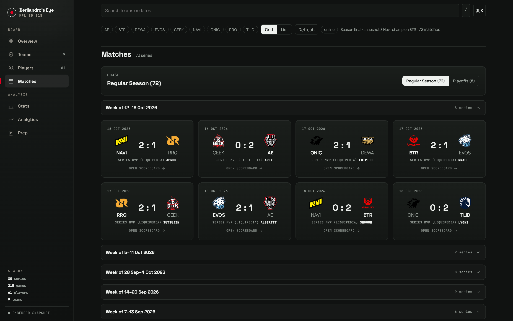

# Berliandro's Eye - MPL ID Season 18

A dark, plate-based instrument panel for exploring **MPL Indonesia Season 18**
(regular season + playoffs): the season front page, nine club dossiers, player profiles,
match scoreboards, the hero meta and a one-page opponent prep.
Ships as **one HTML file plus the committed `assets/` folder** beside it (`mpl_id_s18_dark.html`);
the data is embedded and artwork is referenced by relative path, so the pair works offline from the
snapshot and refreshes live from the mlbbhub API when online.

## Semantic coaching pilot

A separate, auditable transcript/database layer lives in [`analysis/`](analysis/README.md). It imports the local nine-week transcript corpus, verifies hashes, derives timestamps for verified videos, captures gameplay frames with sidecar provenance, and publishes a full-season database evidence pass plus transcript-backed coaching analysis. Current coverage: **27/27 sources validated, 72/72 match reports with database evidence, 27 transcript-covered series (24 complete, 3 partial), 45 DB-only series, and 313 accepted observations.** The coaching product is 9 team briefs plus one head-coach brief; visual proof remains unresolved (0 same-frame `00:00` boundaries). Raw transcripts and screenshots stay local and Git-ignored. Start at [`analysis/reports/coverage-matrix.md`](analysis/reports/coverage-matrix.md).

## Screenshots

### Overview — season front page: latest result, final standings, MVP race, playoffs


### Teams — the league board and nine club dossiers, rating first


### Teams — a club dossier: crest identity, frosted season band, roster, tendencies, draft, H2H


### Players — lane impact, win rate and a six-axis percentile hexagon


### Matches — full-width list with the series MVP per match


### Matches — grid cards, same fixtures


### Scoreboard — mirrored blue/red panels, per-game lines, bans in draft order


### Player profile — identity plate, glass season band, hero pool, derived stats


### Stats — Series MVP race and history


### Stats — Heroes dashboard (highlights + sortable pick/ban/win table)


## Features

- **Overview** — season front page: the latest completed series as a plate (both teams, score,
  series MVP, one click to the scoreboard), a one-line season count, final standings that keep
  official Match W-L and Game W-L separate and link to the club dossiers, the series-MVP race,
  and the last six results. Every block routes somewhere; nothing on it is a dead end.
- **Teams** — a nine-club league board and nine season dossiers. The board opens on the model's
  **Rating** order with a **Standings** toggle and a **Δ** rank column when the two disagree; the
  dossier opens with a crest identity plate and a frosted seven-cell band (series, games,
  win%, rating with CIs, SOS, form, sides), then roster, tendencies, draft, map record at n≥5
  and a 4×2 head-to-head. The top three in competition order are open, the other six one click
  away. Dossiers follow the league: playoff seeds while the bracket is live; after the grand
  final, bracket 1–4, then 5–6 alphabetical, then the non-qualified clubs.
- **Players** — grid cards built on the profile's grammar: cut-out, IGN, team · lane, one
  headline **lane impact**, a supporting row (win rate, KDA, GPM) and a **six-axis percentile
  hexagon** with the 50th-percentile ring; sub-five-game samples render dimmed. The whole card
  is the link; list view keeps the sortable table. Filter by team, lane, search text; sort by
  win rate / lane impact / KDA / kills / gold / games.
- **Matches** — full-width list (date, crests, score, status, series MVP) and grid cards.
  A Regular/Playoffs sub-tab switches phases; the regular phase is the fixture list, the
  playoffs phase adds the **bracket preview** under the history. Completed cards open the
  scoreboard. Team tables live on the Teams tab, not here.
- **Scoreboard dialog** — mirrored blue/red panels with the side as a 3px edge, centered
  header (score, duration, **map mode**, date), full-width **bans in draft order**,
  lane-ordered player rows (EXP/JUNGLE/MID/GOLD/ROAM), a **per-game MVP** next to
  “TEAM won”, and a **VOD deep link**.
- **Player profile** — a full page, not a dialog: cut-out portrait, oversized IGN, team and
  lane lockup, and a glass stat band split **season / last five games** (games, game W-L, KDA,
  K/D/A, GPM, kill participation, damage share). Below it: the hero pool table (GP, AVG KDA,
  per-game K/D/A, GPM; MANIAC/SAVAGE are not in this snapshot and are omitted), a lane-normalised
  profile (close-game WR, effective pool, comfort/flex, damage per gold, tower damage per game),
  the last eight games with result
  pills, the KDA-trend chart, side splits, record by opponent, and top items, emblems and
  talents with drill-downs. Every number keeps its `n` or its reason.
- **Shell** — a left rail groups **Board** (Overview, Teams, Players, Matches) and **Analysis**
  (Stats, Analytics, Prep) at 1180px and wider, with inline SVG icons, live counts for clubs,
  players and series, and one 2px accent bar. Below that width the seven tabs return, in a 4×2
  grid on phones with Prep spanning the last two cells. The player profile hides the header.
- **Stats** — sub-tabbed dashboard: **Series MVP** (race leaderboard + history) and
  **Heroes** (highlight tiles + sortable pick/ban/win table with **role, lane and
  damage-type columns** and share bars).
- **Analytics — Impact** — lane-normalised player impact (35% damage share, 25% kill
  participation, 20% gold share, 10% tower share, −10% death share), shrunk toward
  the lane mean with a 5-game prior. Shows KDA/GPM/damage/KP percentiles, a 95%
  Wilson win-rate interval, form delta, and mutes rows under 5 games. The method
  and weights are printed in-product.
- **Analytics — Draft** — hero pick/ban/WR with CIs and flex, same-team synergy,
  opposing-pair counters, composition archetypes, map meta, and date-window meta
  movement. Pair/counter deltas are labelled as descriptive proxies, not causal. Team-level
  draft fingerprints (top picks/bans, first-ban by side, HHI, pocket picks) live in the Teams
  dossiers.
- **Prep** — pick an opponent (and optionally our team) for a one-page scouting
  report: rating/form/side/tempo, likely picks and bans, a transparent ban ranking,
  player weaknesses/strengths, weak/strong maps, H2H and lane matchups; print/PDF,
  CSV, and a copyable permalink.
- **Search + links** — `Ctrl/⌘K` palette across players, teams, heroes and matches;
  view/teams/analytics/prep state is written to the URL, so a club dossier, a filtered
  match list and a prep report are all shareable.
- **Tables and identity** — Every statistic column sorts ascending/descending with
  a minimalist ▲▼ indicator.
  MVP names from Liquipedia are normalized to one canonical player identity
  (e.g. Coolfire → Joshuaa, JOOOOO → Kevinn, Sutsujin → Arthur,
  Lynchh → Joshua — see `data/global/aliases.json`), so aliases aggregate instead of
  splitting into phantom players; the source spelling is kept as an “as …” note.
  Every hero opens a drill-down modal (picks/bans/WR tiles, most-used
  items/emblems/talents, players with counts, and a game list with
  `DATE | MATCH | GAME | TYPE | RESULT` columns that opens the exact game);
  PICK rows show the hero's team result as Win/Loss while BAN rows stay neutral,
  and assets drill further into global usage.
- **Offline-first** — embedded snapshot renders instantly; Refresh re-fetches live
  data with retry/timeout, merges per-match results (failed match IDs keep
  their previous records, never partial-overwritten), caches to a versioned
  `localStorage` key, and reports `updated` vs `partially updated` status.
  A refresh is labelled final only when all 72 completed regular fixtures have
  detail, the standings totals agree, and every game retains ten picks, two
  team rows, recorded sides and its ordered bans; missing results or draft
  gaps are called out explicitly. Source conflicts and data-quality exceptions
  live in `data/seasons/s18/quality.json` and `meta.json`.
  A failed ETL build keeps the last known-good database/CSVs (rerun to
  retry); a failed refresh keeps showing the last snapshot. To reset cached
  data, clear the site's `localStorage` and reload.

## Stat notes (how derived numbers work)

- **Game MVP**: the mlbbhub API exposes no per-game MVP (game `summary` is empty), so
  the app awards it to the **highest-KDA player on the winning team**
  (tiebreaks: kills, then gold). Series MVP comes from Liquipedia.
- **MANIAC / SAVAGE**: 🚧 **Under development** — no API endpoint (`/match`,
  `/stats/players`, `/stats/heroes`) or official MPL ID page publishes kill-streak
  data (the official leaderboard exists for MPL MY only), so these columns render
  `–` until a source exists. They are never fabricated.
- **Analytics / Prep**: lane percentiles shrink toward the lane mean with a
  5-game prior; win rates use 95% Wilson intervals and show `n`; impact weights
  are pinned by `tools/test_analytics.js`; team ratings are Bradley-Terry on one
  paired observation per game with 100 game-level bootstrap resamples; the ban
  threat score uses opponent pick presence × pick win rate (their own bans are
  context, not input). Formulas and caveats are in-product and in
  [`docs/DATA_DICTIONARY.md`](docs/DATA_DICTIONARY.md).

## Project layout

| Path | What it is |
|---|---|
| `mpl_id_s18_dark.html` | Built app (generated — open this in a browser) |
| `tools/templates/` | Single source: `doc.html`, `style.css`, `app.js` |
| `tools/build_s18_db.py` | API ETL: mlbbhub + Liquipedia → SQLite + `data/csv/` |
| `tools/enrich_drafts.py` | Liquipedia enrichment: picks, lane order, ban order, map mode (idempotent) |
| `tools/fetch_hero_classes.py` | Build `hero_classes.json` from Liquipedia hero infoboxes (role, lane, specialties) |
| `tools/aggregate_teams.py` | Rebuild `team_games` / `team_season_stats` from player rows (no network) |
| `tools/gen_dark.py` | Build: CSV + assets → `mpl_id_s18_dark.html` |
| `tools/derive_team_colors.py` | Derive each team's accent from its logo (lightness-clamped) → `data/global/team_colors.json` |
| `tools/fetch_assets.py` | Download every referenced hero/item asset (`--check-only`, `--live`) |
| `tools/check.py` | Regression suite (incl. STRICT asset coverage + JS syntax gate) |
| `tools/verify.py` | Standard verification: all unit suites + `check.py` + parity gate |
| `tools/import_transcripts.py` | Safe copy + SHA-256 manifest for the local transcript corpus |
| `tools/link_video_source.py` | Verify and record a YouTube video ID for a transcript source |
| `tools/transcript_evidence.py` | Quote/timestamp alignment, evidence build and validation |
| `tools/video_frames.py` | Full-frame screenshot capture + sidecar provenance + contact sheets |
| `tools/verify_analysis.py` | Semantic-coaching pilot tests + ledger/boundary checks |
| `tools/test_chances.js` | Probability-engine tests (node) |
| `tools/test_refresh.js` | Live-refresh merge tests (node) |
| `tools/test_analytics.js` | Analytics engine fixtures: Wilson, shrinkage, player/team/draft metrics, ban ranking (node) |
| `docs/` | Roadmap, data dictionary and insight catalogue |
| `tools/test_cache.js` | Cache versioning + snapshot-fingerprint tests (node) |
| `tools/test_snapshot.js` | Refresh snapshot derivation + enrichment-preservation tests (node) |
| `tools/reconcile.py` | Cross-view Match W-L / Game W-L reconciliation gate |
| `tools/test_reconcile.py` | Committed-snapshot reconciliation regressions |
| `tools/test_config.js` | Season-config tests (node) |
| `tools/test_liqparse.py` | Liquipedia parser + ETL gate tests |
| `tools/test_enrich.py` | Offline draft/lane parser + data-quality gates |
| `tools/test_hero_classes.py` | Hero role/lane/damage coverage gates |
| `tools/test_aggregates.py` | Team aggregate reconciliation gates |
| `tools/test_config.py` | Season-config schema tests |
| `data/season.json` | Validated season rules (teams, slots, priors, endpoints, cache schema 4) |
| `data/registry.json` | Season registry — every season-aware tool resolves paths through it |
| `data/global/` | Season-independent metadata: `aliases.json` (player/team/lane identity), `item_classes.json`, `hero_classes.json`, `team_colors.json` (derived logo accents) |
| `tools/season.py` | Registry resolver (`legacy` and `season-dir` layouts) |
| `tools/check_parity.py` | Regen parity gate |
| `tools/shots.py` | README screenshots per the shooting spec below (Playwright + system Chrome) |
| `assets/` | Downloaded artwork + `manifest.json` |
| `data/` | SQLite DB, CSV exports, `lanes.json` |
| `github/assets/` | README screenshots |

## Commands

```bash
python tools/etl.py --season s18      # full pipeline: API ETL + Liquipedia enrichment (network)
python tools/build.py --season s18    # season-aware build wrapper
python tools/build_s18_db.py   # API-only ETL (no picks/lanes/map mode)
python tools/enrich_drafts.py --season s18  # Liquipedia enrichment alone (network)
python tools/aggregate_teams.py --season s18  # refresh team aggregates (no network)
python tools/fetch_assets.py   # download missing hero/item assets
python tools/fetch_assets.py --live        # also cover season progress
python tools/fetch_assets.py --check-only  # audit only
python tools/gen_dark.py       # rebuild the HTML
python tools/verify.py         # standard regression: unit suites + check.py + parity
python tools/check.py          # data-integrity + asset suite alone (0 failures expected)
node tools/test_chances.js     # probability-engine tests alone
node tools/test_analytics.js   # analytics engine tests alone
python tools/shots.py --zoom # re-capture README screenshots (see spec)
```

## Season onboarding

A new season is supported without application-code changes:

1. Add `data/seasons/<id>/season.json` (teams, aliases, slots, priors, endpoints).
2. Add roster / IGN / lane entries to `data/global/aliases.json`.
3. Register the season in `data/registry.json` with `"layout": "season-dir"`.
4. Run `python tools/etl.py --season <id>` (network). This builds the database
   and enriches picks, lanes, ban order and map mode from Liquipedia.
5. Run `python tools/build.py --season <id>` and `python tools/verify.py`.
6. Review the diff, then commit the season data and generated build.

Enrichment fills `game_picks`, `game_players.lane`/`lane_source`,
`game_bans.ban_order` and `games.map_mode`. It is idempotent: re-running
replaces picks and re-checks every row; unmatched heroes or players are
reported, never guessed. Team aggregates fill `team_games` and
`team_season_stats`.

Season 18 intentionally keeps the `legacy` layout; `data/registry.json` and the
`--season` wrappers resolve it without a physical move. A new season follows the
onboarding checklist above and does not fork application code.

GitHub Actions (`.github/workflows/ci.yml`) runs the build plus
`tools/verify.py` on pushes to `main` and pull requests targeting `main`.
CI uses only committed data and templates — the network ETL and the
Playwright screenshots are manual steps, not CI jobs.

## Screenshot spec (do not change without approval)

- Canvas: **2880×1800 PNG** exact (asserted from the PNG header after capture)
- System zoom **150%** (viewport 1920×1200 CSS @ device scale factor 1.5) +
  website zoom **125%** (body CSS zoom) = zoomed-in, high-resolution look
- Every shot waits for webfonts and all in-viewport images to finish loading —
  no fixed sleeps — so photos and icons are never captured half-loaded

Serve locally (or just double-click the HTML):

```bash
python -m http.server 8931
# → http://localhost:8931/mpl_id_s18_dark.html
```

## Docs

- [Roadmap](docs/ROADMAP.md)
- [Data dictionary](docs/DATA_DICTIONARY.md)
- [Insight catalogue](docs/INSIGHT_CATALOGUE.md)

## Data sources

- Matches, games, per-player stats, drafts: `https://mpl.mlbbhub.com/api/v1/id`
- Series MVPs, schedule cross-check: Liquipedia (`MPL/Indonesia/Season 18`)
- Hero artwork: scoregg CDN, Liquipedia infoboxes (see `tools/fetch_assets.py`)

Data-access notes: the ETL and the in-app Refresh button call public JSON
endpoints and the MediaWiki `api.php` interface with identifying user agents
(`MPL-S18-research/1.0`, `MPL-S18-assets/1.0`), only on manual invocation
(one ETL run ≈ 70 sequential requests; one Refresh ≈ 60 detail requests at
6-way concurrency plus 6 list requests with one retry each). Note that
`robots.txt` disallows crawling `/mobilelegends/api.php` for generic agents,
and the sites' terms of service were not independently reviewed — usage here
is minimal, manual, and non-commercial, but compliance is not claimed.
